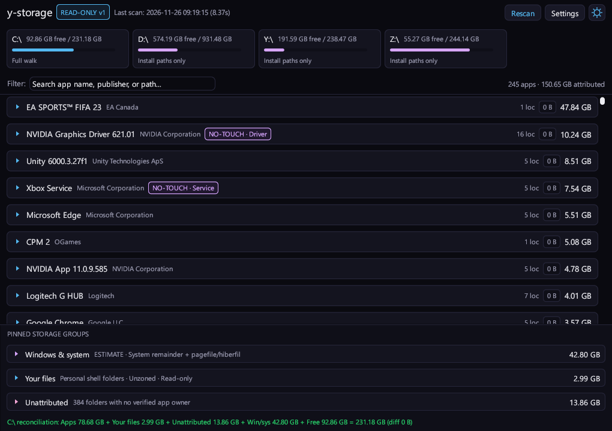
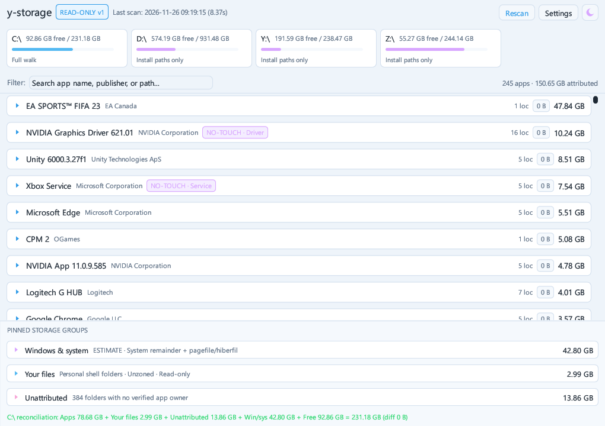

# y-storage

A fast, read-only Windows desktop utility that discovers the **true total storage footprint** of every installed application across install directories, `AppData\Local`, `AppData\Roaming`, `AppData\LocalLow`, `ProgramData`, `Package Cache`, Store `Packages`/`WindowsApps`, and user-profile toolchain homes (`.cargo`, `.rustup`, `.vscode`, `.ollama`).

| Dark Mode | Light Mode |
| :---: | :---: |
|  |  |

## Features (`app-discovery`, `drive-scanner`, `attribution-zones`, `scan-history`, `storage-ui`)

- **One total per app, expandable breakdown**: Combines scattered folders per app and expands into each location with its zone tag (`BODY`, `GREEN`, `RED`, `RED · Roaming config`, `ProgramData · Machine-shared`), attribution basis (`install location`, `exact name match`, `token match`, `publisher match`, `package name`), and `NO-TOUCH` protection badges (`Driver`, `Service`, `Anti-Cheat`, `Runtime`, `Registry`).
- **Every GB has an owner**: Reconciles enabled drives down to the exact byte across **Apps**, **Windows & system** (direct `pagefile.sys`/`hiberfil.sys`/`swapfile.sys` + remainder estimate), **Your files** (personal shell folders — unzoned, unattributed, read-only), and **Unattributed**.
- **Low-I/O on-demand scanning**: Never walks `Windows` or `WinSxS`; skips junctions/symlinks; scans on demand at `THREAD_MODE_BACKGROUND_BEGIN`; caches folder sizes and scan history locally (`%LOCALAPPDATA%\y-storage\`) to surface per-app growth deltas (`+X MB`, `-X MB`, `NEW`, `0 B`).
- **Strictly read-only v1**: Zero delete/move/junction actions; single standalone portable executable (`y-storage.exe`) rendered with pure-CPU `egui` + GDI DIB `SoftwarePainter`.

## Build from Source

```powershell
cargo test --workspace
cargo build --release --workspace
```

The standalone executable is written to `target\release\y-storage.exe`.

## License

`y-storage` is licensed under the [MIT License](LICENSE). Third-party Rust crate licenses are listed in [THIRD-PARTY-LICENSES.md](THIRD-PARTY-LICENSES.md).
